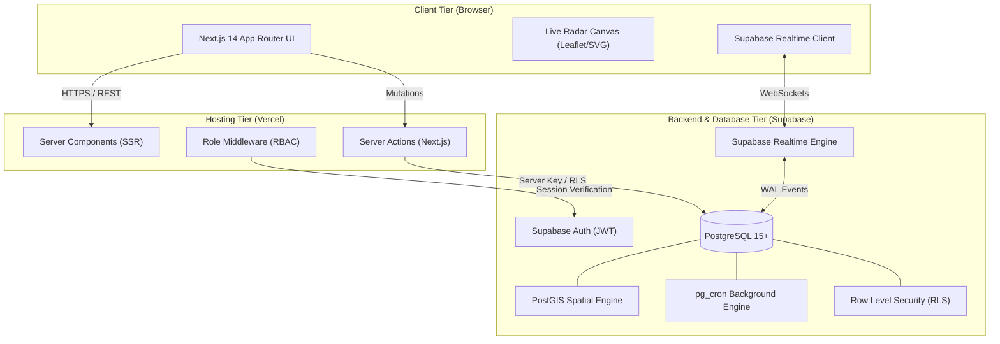
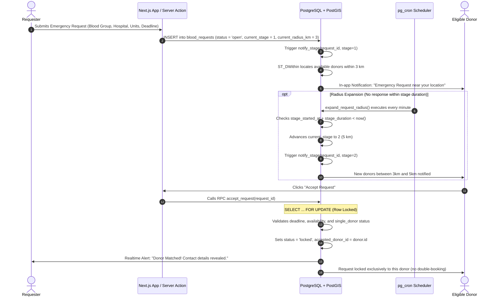

# BloodRadar — System Architecture

**Course:** CSE 3292 – Website Development  
**Project:** BloodRadar (Emergency Blood Response Network)  
**Team:** Digital Pioneers (Individual Project)  

---

## 1. High-Level Architecture Diagram

---

## 2. Component Explanations

### A. Next.js 14 App Router (Frontend & Server Layer)
- **React Server Components (RSC):** Render fast, SEO-friendly initial pages (`/`, `/about`, `/contact`, `/find-donors`) without client-side JavaScript bloat.
- **Server Actions:** Handle form submissions (emergency request creation, contact messages) with server-side Zod validation.
- **Edge Middleware:** Protects authenticated routes (`/dashboard/donor`, `/dashboard/requester`, `/dashboard/admin`), validating session cookies before rendering pages.

### B. Supabase Backend Tier
- **Supabase Auth:** Issues signed JWT tokens storing user roles (`donor`, `requester`, `admin`) in user metadata.
- **PostgreSQL Database:** Enforces schema integrity, foreign keys, `CHECK` constraints, and transactions.
- **PostGIS (`ST_DWithin`):** Calculates geographic proximity directly within SQL on spatial `geography(Point, 4326)` columns using GIST indexing. Manual Haversine math is strictly avoided.
- **pg_cron Engine:** Runs automated background jobs entirely inside the database:
  - `expand_request_radius()`: Runs every minute to advance requests from 3km → 5km → 10km.
  - `expire_overdue_requests()`: Marks requests past their deadline as `expired`.
  - `release_cooldowns()`: Resets expired donor cooldown periods.
- **Row Level Security (RLS):** Ensures that no user can read or modify another user's personal phone number, exact GPS location, or emergency request history.

---

## 3. Data Flow of an Emergency Request

