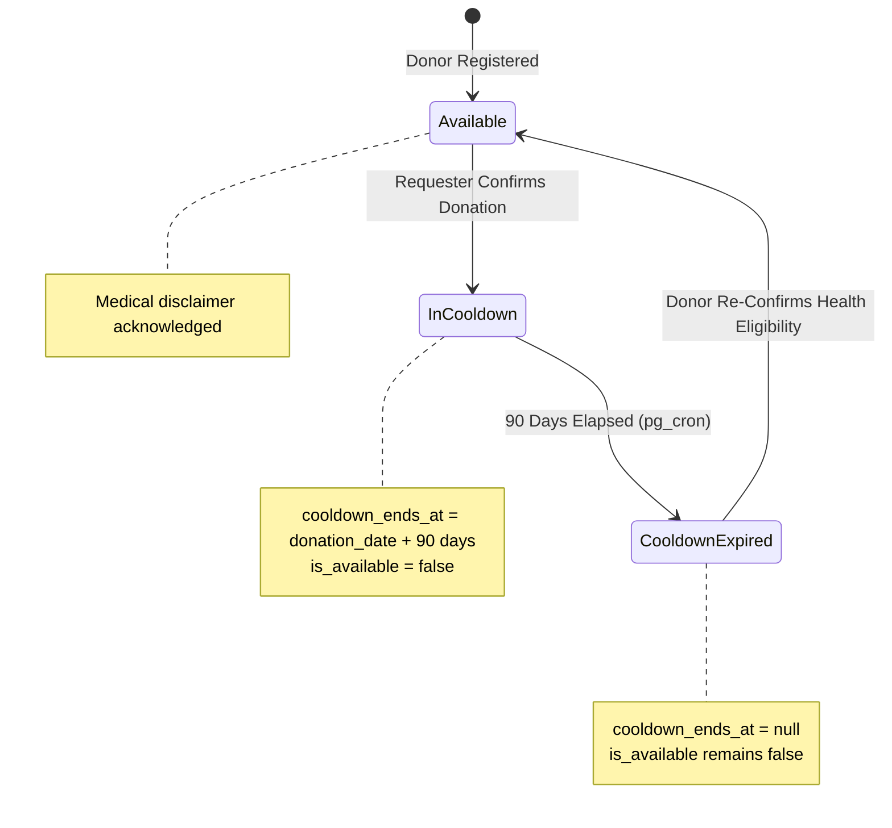

# BloodRadar — 90-Day Donor Cooldown Architecture

**Course:** CSE 3292 – Website Development  
**Project:** BloodRadar (Emergency Blood Response Network)  
**Team:** Digital Pioneers  

---

## 1. Medical Foundation & Purpose

According to international and Directorate General of Health Services (DGHS) guidelines:
- A whole blood donation requires a minimum **90-day recovery period** for hemoglobin, ferritin, and iron stores to replenish safely.
- Donating more frequently puts donors at risk of anemia and compromises patient safety.

BloodRadar enforces this medical requirement programmatically in the database schema.

---

## 2. Cooldown Lifecycle

---

## 3. Database Rules & Safeguards

1. **Triggered on Requester Confirmation:**  
   Cooldown is **not** triggered when a request is accepted. It is triggered when the requester clicks **"Confirm Donation"** via the `confirm_donation()` RPC after the physical donation occurs at the hospital.
2. **Three-Way Exclusion:**  
   A donor with `cooldown_ends_at > now()` is automatically:
   - Excluded from public search (`search_donors()`).
   - Excluded from cascading radius notifications (`notify_stage()`).
   - Blocked from accepting emergency requests (`accept_request()`).
3. **No Silent Re-activation:**  
   When the 90 days elapse, `release_cooldowns()` clears `cooldown_ends_at`. The donor's status remains unavailable until they log into their dashboard and check the medical health declaration checkbox ("I confirm I am feeling healthy, meet weight requirements, and am ready to donate again").
