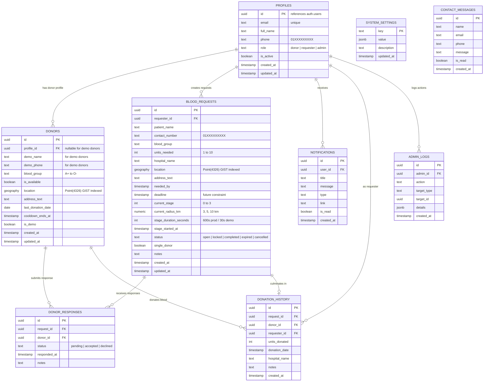

# BloodRadar — Database Architecture & PostGIS Guide

## 1. Overview
BloodRadar uses PostgreSQL (via Supabase) enhanced with the **PostGIS** spatial engine and **pg_cron** scheduler. The database schema coordinates high-urgency blood requests with proximity-matched donors while strictly enforcing privacy boundaries and clinical data integrity.

---

## 2. Entity-Relationship (ER) Diagram



---

## 3. PostGIS Spatial Implementation

### Spatial Column Specification
Locations for donors and hospitals are stored using PostGIS `geography(Point, 4326)`:
- Longitude (X): `-180` to `+180` (Dhaka center approx `90.3817° E`)
- Latitude (Y): `-90` to `+90` (Dhaka center approx `23.7530° N`)

```sql
location extensions.geography(Point, 4326) NOT NULL
```

### Spatial Indexing (GIST)
GIST indexes provide sub-millisecond bounding-box spatial scans:
```sql
CREATE INDEX idx_donors_location_gist ON public.donors USING GIST(location);
CREATE INDEX idx_blood_requests_location_gist ON public.blood_requests USING GIST(location);
```

### Cascading Radius Queries
Concentric stage notification queries use PostGIS `ST_DWithin`:
```sql
SELECT id, demo_name, blood_group,
       round((ST_Distance(location, ST_SetSRID(ST_MakePoint(90.3817, 23.7530), 4326)) / 1000)::numeric, 2) AS distance_km
FROM public.donors
WHERE blood_group = 'O+'
  AND is_available = true
  AND (cooldown_ends_at IS NULL OR cooldown_ends_at <= now())
  AND ST_DWithin(location, ST_SetSRID(ST_MakePoint(90.3817, 23.7530), 4326), 3000)
ORDER BY distance_km ASC;
```

---

## 4. Row-Level Security (RLS) & Privacy Model

1. **Exact Coordinates Privacy:** Raw latitude and longitude coordinates are never exposed to requesters or anonymous users. Distances are computed server-side via `ST_Distance` and displayed as approximate estimates (`~X.X km`).
2. **Contact Number Protection:** A donor's contact phone number remains strictly masked until that donor accepts a specific request via the atomic acceptance procedure. The function `get_accepted_donor_contact(request_id, donor_id)` reveals contact information only to the verified requester.
3. **Role Enforcement:**
   - `donor`: Manages their own donor profile, availability switch, and responses.
   - `requester`: Manages emergency requests and confirms donations.
   - `admin`: Granted platform audit privileges. Designated **only** by direct SQL query on `profiles`.

---

## 5. Migration Execution Order in Supabase

Run the SQL migration scripts in the Supabase SQL Editor in the following order:

1. `20261115000001_extensions.sql` — Enables `postgis`, `pgcrypto`, `pg_cron`.
2. `20261115000002_core_schema.sql` — Creates tables, foreign keys, and constraints.
3. `20261115000003_spatial_and_indexes.sql` — Creates GIST and B-Tree indexes.
4. `20261115000004_triggers_and_auth.sql` — Sets up `handle_new_user` and `updated_at` triggers.
5. `20261115000005_rls_policies.sql` — Applies explicit Row Level Security policies.
6. `seed.sql` — Populates 40 realistic demo donors across Dhaka and 1 demo requester.
7. `verify.sql` — Executes the test verification suite.
